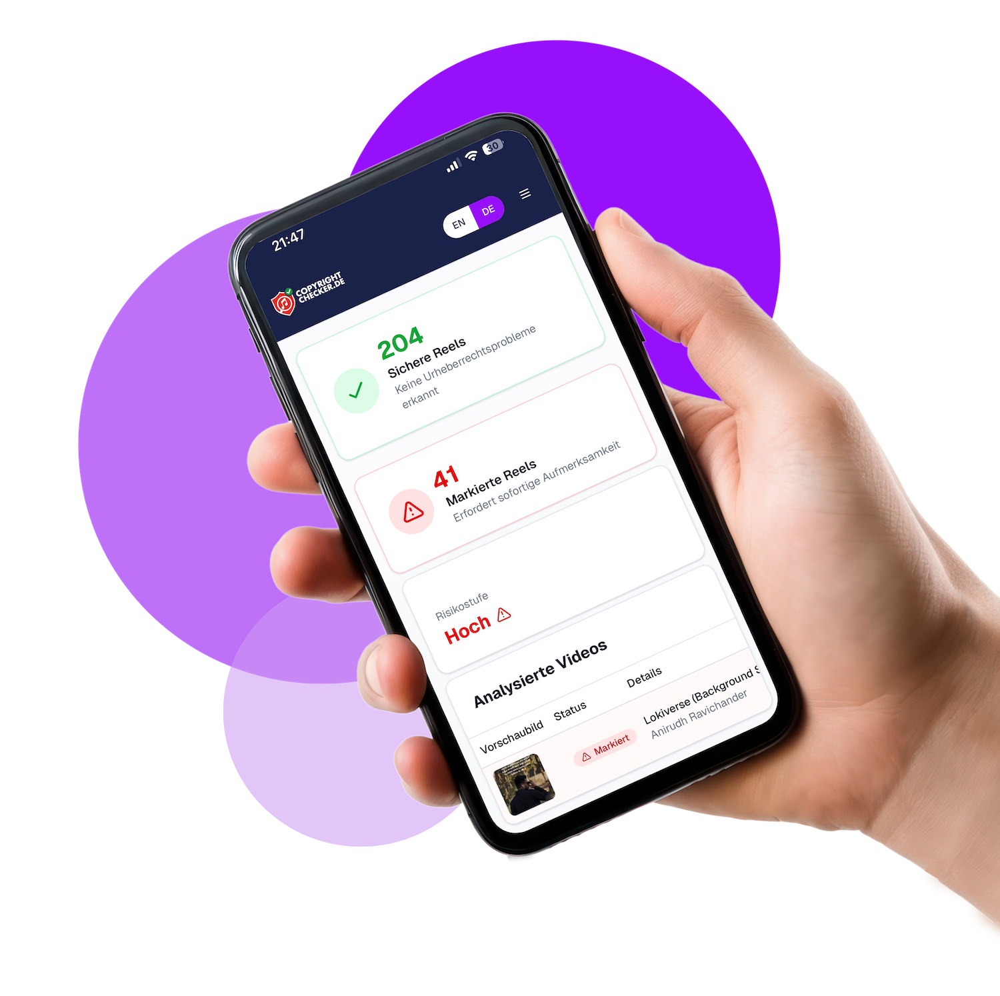
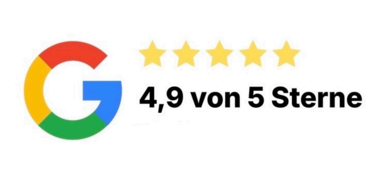

<div align="center">

<!-- Hero Banner & Header Logo -->
<a href="https://github.com/TAIJULAMAN/copywright-music-detect-website">
  
</a>

<br />
<br />

<a id="overview"></a>

# CopyrightChecker — AI-Powered Instagram Music Copyright Detection Platform

**An intelligent, multi-lingual audio fingerprinting and copyright risk assessment platform empowering content creators, digital agencies, and influencers to scan Instagram Reels for audio infringements without account credentials.**

<br />

<a id="tech-stack"></a>

<!-- Tech Stack Badges (for-the-badge style) -->

[](https://nextjs.org/)
[](https://react.dev/)
[](https://www.typescriptlang.org/)
[](https://tailwindcss.com/)
[](https://redux-toolkit.js.org/)
[](https://next-intl-docs.vercel.app/)
[](https://www.radix-ui.com/)
[](https://www.paypal.com/)
[](https://zod.dev/)
[](#license)

<br />

<a id="cta-links"></a>

<!-- Live Demo & CTA Links -->
<p align="center">
  <a href="#overview"><b>Explore Platform</b></a> &nbsp;•&nbsp;
  <a href="#architecture"><b>Architecture</b></a> &nbsp;•&nbsp;
  <a href="#core-features"><b>Core Features</b></a> &nbsp;•&nbsp;
  <a href="https://github.com/TAIJULAMAN/copywright-music-detect-website/issues"><b>Report Bug</b></a> &nbsp;•&nbsp;
  <a href="https://github.com/TAIJULAMAN/copywright-music-detect-website/issues"><b>Request Feature</b></a>
</p>

<br />

<!-- Hero Banner Graphic -->


</div>

---

## 📑 Table of Contents

- [ Title & Value Proposition](#overview)
- [ Tech Stack Badges](#tech-stack)
- [ Live Demo & CTA Links](#cta-links)
- [ Interface Preview](#interface-preview)
- [ Core Features & Platform Modules](#core-features)
  - [ Instagram Reels Audio & Copyright Scanner](#audio-scanner)
  - [ Zero-Credential Public Profile Analysis](#zero-credential)
  - [ Comprehensive Audit Reports & Direct Remediation](#audit-reports)
  - [ Bilingual Localization (EN / DE)](#localization)
  - [ Flexible Credit Tiers & PayPal Checkout](#credit-tiers)
  - [ Invoicing, VAT Compliance & Billing Portal](#invoicing-billing)
  - [ Dynamic Content CMS & Help Hub](#content-cms)
- [ Engineering Highlights & Architecture](#architecture)
  - [ System Architecture Overview](#system-architecture)
  - [ User Journey & Scan State Matrix](#workflow-matrix)
- [ Project Directory Structure](#project-structure)
- [ Developer Info & Socials](#developer-info)
- [ License & Proprietary Notice](#license)

---

<a id="interface-preview"></a>

## 🖼️ Interface Preview

Experience automated Instagram copyright auditing, waveform analysis, and multilingual localization engineered with Next.js 16, Tailwind CSS 4, Radix UI, and next-intl.

|                         **Automated Audio & Reel Scanner**                         |                            **Detailed Audio Match Breakdown**                             |
| :--------------------------------------------------------------------------------: | :---------------------------------------------------------------------------------------: |
|  |  |
|              _Instant profile URL input with non-invasive scanning_                |                  _Risk evaluation, matched song data & timestamp alerts_                  |

|                          **Secure PayPal Integration**                             |                            **Verified Creator Ratings**                                   |
| :--------------------------------------------------------------------------------: | :---------------------------------------------------------------------------------------: |
|      |              |
|                 _One-time scans & tiered subscription packages_                    |                  _Trusted by influencers, talent managers & brands_                      |

---

<a id="core-features"></a>

## ✨ Core Features & Platform Modules

CopyrightChecker delivers professional acoustic intelligence, automated audio fingerprinting, and risk detection for digital agencies, influencers, and brands.

<a id="audio-scanner"></a>

### **Instagram Reels Audio & Copyright Scanner**

- **Audio Fingerprint Matching**: Analyzes background music and audio tracks across public Reels against global commercial music copyright catalogues.
- **Risk Scoring Algorithm**: Categorizes audio into low, medium, and severe copyright risks to help creators avoid takedowns and account strikes.
- **Timestamped Match Identification**: Pinpoints exact song titles, artists, record labels, and timestamps within analyzed video clips.
- **Direct Remediation Links**: Provides instant deep-links to flagged Reels for immediate soundtrack muting, replacement, or deletion.

<a id="zero-credential"></a>

### **Zero-Credential Public Profile Analysis**

- **No Instagram Login Required**: Safely inspects public creator feeds without requesting Instagram account passwords or API authorizations.
- **URL-Based Discovery**: Simply enter an Instagram profile handle or link (e.g., `instagram.com/creator`) to initiate batch Reel extraction.
- **Privacy First**: Operates with read-only public data extraction, protecting account credentials and safeguarding against account locks.

<a id="audit-reports"></a>

### **Comprehensive Audit Reports & Direct Remediation**

- **Instant Scan Reports**: Interactive breakdown summarizing total videos analyzed, percentage of copyrighted music, and safe clips.
- **Historical Scan Archive**: Registered users can review historical audits, track trends over time, and download structured reports.
- **Waveform Inspection**: Visual representation of flagged audio segments alongside detected commercial tracks.

<a id="localization"></a>

### **Bilingual Localization (EN / DE)**

- **Full Locale Routing**: Dynamic internationalization powered by `next-intl` supporting English (`/en`) and German (`/de`).
- **European Regulatory Compliance**: Includes a dedicated German Impressum (`/[locale]/imprint`) satisfying German Telemedia regulations (TMG).
- **Localized UI Terminology**: Seamless currency formats, terminology, and legal notices tailored for DACH and international markets.

<a id="credit-tiers"></a>

### **Flexible Credit Tiers & PayPal Checkout**

- **Tiered Packages**: Supports both single-profile one-time audits and multi-account monthly subscription quotas.
- **PayPal Payment Gateway**: Seamless and secure PayPal checkout integration (`paypal.png`, `paypalcheckout button.png`).
- **Coupon & Promotional Codes**: Automated discount validation engine enforcing single-use restrictions per account.

<a id="invoicing-billing"></a>

### **Invoicing, VAT Compliance & Billing Portal**

- **Automated VAT Calculation**: Transparent breakdown including German 19% VAT (`inkl. 19% MwSt.`) on checkouts and invoices.
- **Invoices Repository (`/invoices`)**: Download and view printable receipts, invoice numbers, and payment transaction logs.
- **Subscription Management (`/mysubscription`)**: Track remaining scan balance, active plan limits, and renewal dates.

<a id="content-cms"></a>

### **Dynamic Content CMS & Help Hub**

- **Copyright Knowledge Blog (`/blog`)**: Educational guides on social media music licensing, royalty-free audio, and DMCA policy.
- **Creator FAQ Center (`/faq`)**: Searchable knowledge base addressing common questions on fair use, commercial licenses, and scanner mechanics.
- **Contact & Support Pipeline (`/contact`, `/help`)**: Integrated inquiry dispatch connecting creators with dedicated support representatives.

---

<a id="architecture"></a>

## 🏗️ Engineering Highlights & Architecture

<a id="system-architecture"></a>

### System Architecture Overview

CopyrightChecker is built upon Next.js 16 App Router, `next-intl` localization middleware, Redux Toolkit for state and caching, and an asynchronous audio analysis pipeline.

```
+-----------------------------------------------------------------------------------+
|                        Client & Presentation Layer (Browser)                      |
|   Next.js 16 App Router | React 19 | Tailwind CSS 4 | Shadcn UI | next-intl       |
+-----------------------------------------------------------------------------------+
                                          │
                                          ▼ (proxy.ts / Internationalized Middleware)
+-----------------------------------------------------------------------------------+
|                      Middleware Proxy & Authentication Layer                      |
|   Locale Matcher (/en, /de) | Cookie Token Interceptor | Protected Route Shield   |
+-----------------------------------------------------------------------------------+
                                          │
                                          ▼ (RTK Query / Redux Store / baseApi.ts)
+-----------------------------------------------------------------------------------+
|                           State Management & API Gateway                          |
|   Redux Toolkit | copyrightApi.ts | subscriptionApi.ts | authSlice | PayPal SDK   |
+-----------------------------------------------------------------------------------+
                                          │
                                          ▼ (RESTful Endpoints / Backend Workers)
+-----------------------------------------------------------------------------------+
|                        Audio Extraction & AI Analysis Engine                      |
|   Public Reel Scraper | Audio Extraction | Fingerprint Matching | Music Database  |
+-----------------------------------------------------------------------------------+
```

<a id="workflow-matrix"></a>

### User Journey & Scan State Matrix

| Feature / Action               | Anonymous Visitor | Registered User | Active Subscriber |
| :----------------------------- | :---------------: | :-------------: | :---------------: |
| **Browse Landing, Blog & FAQ** |    Full Access    |   Full Access   |    Full Access    |
| **Switch Language (EN / DE)**  |    Full Access    |   Full Access   |    Full Access    |
| **Submit Profile for Scan**    |  Single Reel Test | Quota Dependent | Unlimited / Tier  |
| **View Summary Results**       |    Full Access    |   Full Access   |    Full Access    |
| **Detailed Waveform & Songs**  |   Requires Auth   |   Full Access   |    Full Access    |
| **Download PDF Audit Reports** |        ❌         |    Available    |    Full Access    |
| **Access Invoices & Billing**  |        ❌         |   Full Access   |    Full Access    |
| **Manage Subscription Quota**  |        ❌         |   Full Access   |    Full Access    |

---

<a id="project-structure"></a>

## 📂 Project Directory Structure

```plaintext
copywright-music-detect-website/
├── app/                                # Next.js 16 App Router with next-intl localization
│   └── [locale]/                       # Internationalized route tree (/en, /de)
│       ├── about/                      # About CopyrightChecker platform & methodology
│       ├── blog/                       # Copyright compliance guides, news & music industry articles
│       ├── checkout/                   # Plan checkout, order review & payment processing
│       ├── contact/                    # Customer support & enterprise inquiries
│       ├── faq/                        # Frequently asked questions & audio analysis guide
│       ├── forgot-password/            # Password recovery flow
│       ├── help/                       # Creator assistance & scan troubleshooting
│       ├── imprint/                    # Legal impressum & regulatory corporate disclosures
│       ├── invoices/                   # User invoice ledger with VAT calculations (19% MwSt.)
│       ├── login/                      # User authentication & token generation
│       ├── mysubscription/             # Active plan status, scan quota & renewal control
│       ├── payment/                    # Payment gateway confirmation & webhook status
│       ├── pricing/                    # Transparent one-time analysis & tier pricing cards
│       ├── privacy/                    # GDPR-compliant privacy policy & cookie handling
│       ├── profile/                    # User account management, email & security settings
│       ├── report/                     # Individual scan analysis reports with direct Reel links
│       ├── reset-password/             # Token-authenticated password reset
│       ├── results/                    # Audio match results, waveform risks & match percentages
│       ├── scan/                       # Instagram profile input & real-time scan initiation
│       ├── signup/                     # New creator account registration
│       ├── terms/                      # Terms of service & analysis disclaimers
│       ├── verify-otp/                 # One-time passcode email verification
│       ├── layout.tsx                  # Root localized layout with next-intl Provider
│       ├── loading.tsx                 # Suspense skeleton fallback loaders
│       └── page.tsx                    # Landing page (Hero, How It Works, Pricing, Testimonials)
├── components/                         # Atomic, layout & feature UI components
│   ├── ui/                             # Radix UI & Shadcn primitive components (Accordion, Dialog, Tabs)
│   ├── header.tsx                      # Localized global navigation with locale switcher
│   ├── hero.tsx                        # High-converting hero banner with URL input
│   ├── footer.tsx                      # Multi-column footer with regulatory links
│   └── ...                             # Feature-specific modals, cards & drawers
├── hooks/                              # Custom React logic hooks & media query listeners
├── i18n/                               # Internationalization routing & request configuration
│   ├── routing.ts                      # Locale definitions ('en', 'de') & prefix strategy
│   └── request.ts                      # Server-side message loading pipeline
├── lib/                                # Core utility functions, class mergers & helpers
├── messages/                           # Localization string dictionaries
│   ├── en.json                         # English translation strings
│   └── de.json                         # German translation strings (inkl. 19% MwSt.)
├── public/                             # Public static assets (logos, illustrations, payment badges)
├── redux/                              # Global state management with Redux Toolkit
│   ├── api/                            # RTK Query API slices
│   │   ├── aboutApi.ts                 # About page dynamic content endpoint
│   │   ├── authApi.ts                  # Authentication, JWT & user session API
│   │   ├── baseApi.ts                  # Centralized fetchBaseQuery with auth headers
│   │   ├── blogApi.ts                  # Educational blog publication endpoints
│   │   ├── config.ts                   # Backend URL & image path resolvers
│   │   ├── contactApi.ts               # Contact form dispatch endpoints
│   │   ├── copyrightApi.ts             # Reel audio extraction & copyright detection endpoints
│   │   ├── faqApi.ts                   # Knowledge base & FAQ endpoints
│   │   ├── privacyApi.ts               # Privacy policy content endpoints
│   │   ├── subscriptionApi.ts          # Subscription tiers, credit packs & PayPal order capture
│   │   ├── termsApi.ts                 # Terms of service content endpoints
│   │   └── userApi.ts                  # User profile, history & invoice endpoints
│   ├── slices/                         # Redux synchronous slices (authSlice)
│   ├── provider.tsx                    # Client-side Redux Provider wrapper
│   └── store.ts                        # Redux store with redux-persist integration
├── styles/                             # Custom CSS stylesheets & animation overrides
├── proxy.ts                            # Next.js Middleware handling auth checks & next-intl routing
├── next.config.mjs                     # Next.js compiler config & image hostname whitelists
├── package.json                        # Project dependencies, build scripts & metadata
├── postcss.config.mjs                  # PostCSS plugins for Tailwind CSS v4
├── tsconfig.json                       # TypeScript compiler options & module paths
└── components.json                     # shadcn/ui configuration manifest
```

---

<a id="developer-info"></a>

## 👨‍💻 Developer Info & Socials

CopyrightChecker is architected and maintained by specialized full-stack engineers and multimedia system developers.

- **Md Shah Aman Patwary** — _Lead Full-Stack Software Engineer & Maintainer_
  - 🌐 GitHub: [@TAIJULAMAN](https://github.com/TAIJULAMAN)
  - 📧 Email: [taijulaman8@gmail.com](mailto:taijulaman8@gmail.com)

- **Md. Parves Mosarof** — _Full-Stack Software Engineer & Contributor_
  - 🌐 GitHub: [@parvesmosarof35](https://github.com/parvesmosarof35)
  - 📧 Email: [parvesmosarof35@gmail.com](mailto:parvesmosarof35@gmail.com)

---

<a id="license"></a>

## 📄 License & Proprietary Notice

Copyright © 2026 CopyrightChecker. All rights reserved.

This software, including its proprietary audio scanning algorithms, user interface, and translation architecture, is private and confidential. Unauthorized copying, distribution, decompilation, or commercial exploitation without prior written consent from the copyright owners is strictly prohibited.

<div align="center">
  <b>Built with ❤️ to protect creator content and simplify copyright compliance worldwide</b>
</div>
